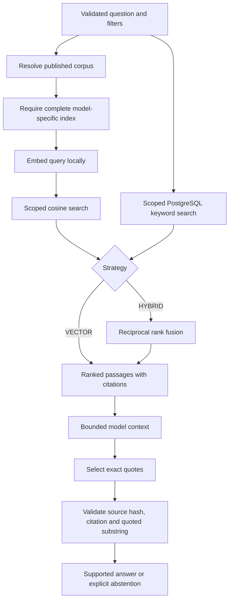

# Week 27: retrieval quality and modular RAG

This implementation builds on Week 26's versioned knowledge pipeline. It retrieves evidence from a published corpus, compares vector and hybrid search, and returns answers made of validated source quotations. Each added or changed source file begins with an explanation of how it works and why its decisions fit this learning project.

## Read the code in this order

| File under`src/main/java/com/fraudengine/`                | What to understand                                                                            |
| ----------------------------------------------------------- | --------------------------------------------------------------------------------------------- |
| `knowledge/api/dto/RetrievalRequest.java`                 | User query, snapshot, strategy, result limit, type/date filters; no caller-assigned clearance |
| `knowledge/api/dto/Citation.java`                         | Exact source revision, chunk identity, and both digests                                       |
| `knowledge/api/dto/RetrievalResult.java`                  | Evidence and retrieval version envelope                                                       |
| `knowledge/api/dto/AnswerResult.java`                     | Answer status and quotation support, separate from retrieval                                  |
| `knowledge/retrieval/RetrievalRepository.java`            | Shared corpus/clearance/date scope, cosine distance, lexical ranking, model-specific index    |
| `knowledge/retrieval/RetrievalIndexService.java`          | Explicit re-embedding with small per-chunk transactions and repeatable writes                 |
| `knowledge/retrieval/ReciprocalRankFusion.java`           | Combine ranks without pretending keyword and cosine scores use the same scale                 |
| `knowledge/retrieval/RetrievalService.java`               | Resolve snapshot, require complete index, choose strategy                                     |
| `knowledge/retrieval/AnswerService.java`                  | Hash/citation/quote validation and explicit abstention                                        |
| `platform/gateway/RetrievalEmbeddingPort.java`            | Provider-neutral vector contract and version identity                                         |
| `platform/gateway/EvidenceAnswerPort.java`                | Narrow model authority: propose quotes from supplied evidence                                 |
| `platform/gateway/RetrievalModelConfig.java`              | Spring constructor/bean wiring for independent model adapters                                 |
| `platform/gateway/provider/OllamaLocalClient.java`        | Loopback-only HTTP, timeouts, installed-model digests                                         |
| `platform/gateway/provider/OllamaRetrievalEmbedding.java` | Real semantic embedding API with truncation disabled                                          |
| `platform/gateway/provider/OllamaEvidenceAnswer.java`     | Optional structured local-model quote selection                                               |
| `platform/gateway/provider/ExtractiveAnswerAdapter.java`  | Deterministic quotation baseline with visible relevance limitations                           |
| `knowledge/infrastructure/RetrievalController.java`       | Validated HTTP operations and distinct setup/model errors                                     |
| `knowledge/retrieval/RetrievalEvaluator.java`             | Same-dataset strategy comparison, measured failures, versioned evidence                       |
| `knowledge/retrieval/RetrievalEvaluationRunner.java`      | Opt-in repeatable operational comparison                                                      |

`CorpusUnavailableException`, `IndexUnavailableException`, and `ModelUnavailableException` preserve the difference between setup failure and a legitimate unknown answer. `FixtureRetrievalEmbedding` provides explicitly labelled offline integration-test vectors. Package documentation explains boundaries. `RetryingJobLauncher` repairs the transient Batch launch conflict exposed by concurrent regression testing while keeping SERIALIZABLE repository behavior.

## Follow one question through the system



For “What evidence is required for a chargeback?”, the request resolves a corpus version and returns ranked passages. Each citation names the precise source revision, such as `policies/chargeback-policy@3`. The answer selector proposes quotations. The service verifies their chunk IDs and that each quotation occurs in the permitted passage. It then builds the final answer from accepted quotations and backend-owned citations.

A model cannot create source identity, enlarge clearance, retrieve a restricted KYC chunk, or authorize account actions through this interface.

## Decisions and their trade-offs

### Separate model-specific index

V7 adds `knowledge.retrieval_spaces` and `knowledge.retrieval_embeddings`. Week 26's `vector_store` remains the authoritative chunk-text store, with a generated full-text search column added by the new migration. Existing migrations are not rewritten.

The retrieval index uses `(chunk_id, embedding_space)` as its unique key. A space pins provider/model digest, dimensions, and whether embeddings are fixtures. Week 26 hash vectors and semantic vectors never share that identity. A model change needs explicit indexing; an incomplete index returns 409 instead of silently searching stale vectors.

We use exact cosine search over the small filtered corpus. It is easy to reason about and avoids approximate-search filtering surprises. The trade-off is linear scan cost. A production-sized corpus will need measured index design, background migration, and capacity testing.

### Shared retrieval scope

Both strategies join published corpus membership to registry, lineage, and text. They apply the same document classification, type, and effective-date constraints. This prevents failed/unpublished revisions or a newer revision from leaking into an older snapshot.

The development clearance is server-controlled C0–C2. HTTP callers cannot self-declare C3 access. This is one local service identity, not a finished multi-user authorization system. Full authenticated per-user clearance belongs to the security work.

Indexing includes future-effective documents that belong to the snapshot; query-time date filters decide whether they are applicable. This lets an already-built index answer a historical or future-date request correctly.

### Vector versus hybrid search

VECTOR ranks cosine similarities above the configured candidate threshold. HYBRID adds PostgreSQL English full-text candidates and merges both lists using reciprocal-rank fusion: `1 / (60 + rank)`. A passage found by both signals gains support.

VECTOR is the default after measuring the local semantic comparison: it had slightly better first-hit ranking and avoids the extra lexical/fusion path. HYBRID remains selectable; its value depends on query mix, and this small dataset does not establish universal superiority.

Keyword queries use normalized word tokens joined with OR, so one missing keyword does not eliminate a useful passage. PostgreSQL handles stemming and stop words. The trade-off is broader candidates and possible lexical distractors. We do not implement an LLM query rewriter or a learned reranker yet; the comparison report determines whether those would help.

The default candidate pool is at least 20 and at most 100, with 4×k where larger. Similarity admission, candidate count, and fusion constant appear in the retrieval configuration version. VECTOR cosine scores and HYBRID fusion scores are not probabilities and are not interchangeable thresholds.

### Quotations before arbitrary paraphrases

The answer port proposes up to three exact quotations. The service checks text hashes, IDs, and source substrings and rejects the entire proposal if any claim is unsupported. Empty evidence, empty selections, and invalid output are explicit statuses. Context is bounded at 16,000 characters, and a quotation is bounded at 4,000.

This gives a useful deterministic grounding guarantee: accepted quoted text exists in the cited retrieved passage. It does not prove the quote answers the question, is complete, or comes from a legally authoritative source. The dataset therefore scores answer relevance separately.

The baseline selector uses meaningful query-word overlap. It is reproducible and keeps table/section context, but can miss paraphrases. Optional Ollama selection uses the same exact-quote contract with structured JSON. Schema constraints and prompt wording do not replace backend checks.

### Idempotent indexing and retry limits

Inference occurs outside the short database insert transaction. A unique key handles concurrent attempts, and report counters count actual inserted versus reused rows. Partial indexing is safe to rerun; retrieval requires all eligible chunks to be indexed for the selected space.

The index endpoint is synchronous and limited to 1000 eligible chunks. This is suitable for the 42-chunk learning corpus. It is not a durable bulk migration worker. Local HTTP calls have finite timeouts and no automatic cloud fallback. Later workflow work should move large re-embedding to a background job.

## Run locally with Ollama

The selected semantic setup is local Ollama with `embeddinggemma`. Install/run Ollama using its official distribution, then:

```bash
ollama pull embeddinggemma
ollama serve
```

If the server is already running, do not start a second one. The runtime used during this implementation is portable and stored under ignored `.runtime/ollama/`; model weights live under ignored `.runtime/models/`. If `ollama` is not on your PATH, run `.runtime/ollama/ollama` in place of `ollama`, or define `alias ollama="$PWD/.runtime/ollama/ollama"` in your terminal. That project-local server can be started with:

```bash
OLLAMA_MODELS="$PWD/.runtime/models" OLLAMA_HOST=127.0.0.1:11434 .runtime/ollama/ollama serve
```

Start the database and app:

```bash
docker compose up -d postgres
mvn spring-boot:run -Dspring-boot.run.profiles=local,ollama
```

Week 26 ingestion still uses its own local fixture; Week 27 explicitly re-embeds the published chunk text semantically. This is intentional isolation.

```bash
curl -X POST http://localhost:8080/v1/knowledge/ingestions \
  -H 'Content-Type: application/json' -d '{"runKey":"week27-corpus-1"}'
# Poll the returned runId until the ingestion completes, then index the latest corpus:
curl -X POST http://localhost:8080/v1/knowledge/retrieval/index \
  -H 'Content-Type: application/json' -d '{}'
curl -X POST http://localhost:8080/v1/retrieve \
  -H 'Content-Type: application/json' \
  -d '{"query":"What evidence is required for a chargeback?","strategy":"HYBRID","topK":5}'
curl -X POST http://localhost:8080/v1/knowledge/answers \
  -H 'Content-Type: application/json' \
  -d '{"query":"What evidence is required for a chargeback?","strategy":"HYBRID","topK":5}'
```

Pin `corpusVersion` for evaluation. Optional filters are `docType` (`policy`, `prior_case`, `regulatory`) and ISO `asOf` date. The date denotes midnight UTC with an inclusive effective-from/exclusive effective-to interval.

Without the `ollama` profile, fixture/extractive adapters remain available and explicitly labelled in responses. Unknown corpus or missing index returns 409. Model unavailability/malformed provider response returns 503. A valid question without sufficient verified evidence returns 200 with `INSUFFICIENT_EVIDENCE`; it is not confused with a broken environment.

Optional local LLM quotation selection:

```bash
ollama pull gemma3:4b
RETRIEVAL_ANSWER_PROVIDER=ollama mvn spring-boot:run -Dspring-boot.run.profiles=local,ollama
```

Choose an answer model that fits your machine and set `OLLAMA_ANSWER_MODEL` accordingly. The selected chat model must be installed separately; embeddings and answer models serve different purposes.

## Evaluate both strategies

`eval/datasets/week27-retrieval.json` contains a documented question set with expected source revision and section. It includes known evidence, ambiguous duplicate lessons, a paraphrase, and unsupported questions.

```bash
mvn test
mvn spring-boot:run -Dspring-boot.run.profiles=local,ollama \
  '-Dspring-boot.run.arguments=--knowledge.eval.enabled=true --spring.main.web-application-type=none --knowledge.eval.output=eval/reports/week27'
```

The opt-in runner ingests the bundled corpus, indexes it, evaluates VECTOR and HYBRID with k=5, exports JSON/Markdown, and exits. Use a separate disposable database for clean comparison evidence. The runner never clears a database.

Metrics:

- Recall@k: fraction of labelled relevant passages found.
- Precision@k: fraction of returned passages that match a label.
- MRR: reciprocal rank of the first correct passage.
- Answer relevance: accepted quotes cite a labelled answer passage. The quote need not repeat the Markdown heading. This remains a passage-level relevance rubric, not a claim of full semantic completeness.
- Quote support: accepted quotes exactly occur in a passage with the same citation.
- Unknown abstention: unsupported questions return insufficient evidence.
- Mean latency: serial observed end-to-end time after explicit warm-up, not a load-test percentile. Execution order and machine load can still affect it.

A 100% quote-support rate can coexist with poor relevance. A small training corpus and dataset do not establish production fraud performance. Review failure examples instead of interpreting one aggregate score as proof of correctness. This Week 27 harness compares retrieval configurations; the broader model/prompt regression release gate belongs to Week 30.

## Review limitations before advancing

- Per-user authentication, source-trust enforcement, comprehensive injection defenses, encryption, and retention remain later work.
- Only installed local model inference is supported by the new retrieval adapters; no external provider fallback is implemented.
- Server clearance defaults to C2 for this local learning identity. Bind the app with the `local` profile and use synthetic sources.
- Query rewriting, contextual summaries, cross-encoder reranking, streaming answers, and production-scale indexing are not claimed.
- Context compression is extractive selection of bounded passages/quotes; oversized evidence can cause abstention.
- The existing bundled regulatory texts are synthetic ingestion fixtures, not authoritative regulation.
- A model-space digest protects index identity. Existing Week 26 source lineage and snapshots remain intact.
- Indexing/report timestamps and latency change between runs; dataset digest, corpus membership, config, and model identity are the comparison controls.

## Verified results and decision review — 13 October 2026

`mvn -q verify` passed **43 tests** with zero failures, errors, or skipped tests. This includes the original ingestion regressions, eight real retrieval-database tests, quotation rejection, rank fusion, launch retry, and local Ollama wire contracts. [Verification details](evidence/week27/verification.json).

The real semantic run used the downloaded EmbeddingGemma model through Ollama 0.40.3, with its installed digest recorded in the report. It evaluated 12 answerable questions and 2 unknown questions on one published corpus at k=5. [Measured comparison](evidence/week27/semantic/retrieval-comparison.md), [complete question-level JSON](evidence/week27/semantic/retrieval-comparison.json), and [index counts](evidence/week27/index-summary.json).

| Decision evidence   | VECTOR | HYBRID |
| ------------------- | -----: | -----: |
| Recall@5            |  1.000 |  1.000 |
| Precision@5         |  0.233 |  0.233 |
| MRR                 |  0.958 |  0.944 |
| Answer relevance    |  0.917 |  0.917 |
| Exact quote support |  1.000 |  1.000 |
| Unknown abstention  |  1.000 |  1.000 |

**Review:** both strategies found every labelled passage. VECTOR ranked the first correct passage slightly better, so it is the default; hybrid remains available. Low precision reflects returning five candidates where most questions have one labelled passage. The selector reduces the final context, but this result still calls for better relevance selection rather than celebrating recall alone.

**Retained failure:** “Which paperwork proves that the goods reached the buyer?” retrieves the expected evidence, but the deterministic selector misses the paraphrase. VECTOR abstains; HYBRID selects a supported yet less relevant quotation. This is direct evidence that citation validity is insufficient to establish answer relevance. A subsequent improvement should evaluate semantic quote selection or a reviewed reranker against these same questions plus held-out paraphrases.

The actual run used deterministic extractive answers with real semantic retrieval. The optional local LLM selector has wire-contract and deterministic-backend rejection tests; a downloaded chat-model run is not claimed. Earlier timing observations changed with model warm-up; the final harness explicitly warms each strategy, and its serial latency samples remain too small to justify a performance conclusion.

No existing user database was reset. The verification database is a separate task container on port 55427. Runtime binaries/model weights are ignored local dependencies, not repository deliverables. No commit, submission tag, or deployment was performed.

## Questions to check your understanding

1. Why does switching the semantic model require another index space?
2. Which SQL joins prevent a failed ingestion revision from being searched?
3. Why can't an HTTP request raise its own classification ceiling?
4. Why are fusion scores unsuitable as answer-confidence probabilities?
5. Can a valid citation accompany an irrelevant answer? Find an example in the report.
6. Where does an invented model quotation get rejected?
7. Why does inference run outside the short database transaction?
8. How do missing index, unknown answer, and model failure differ at the API?

Official references used: [Ollama embedding API](https://docs.ollama.com/api/embed), [PostgreSQL full-text search](https://www.postgresql.org/docs/16/textsearch-controls.html), [pgvector](https://github.com/pgvector/pgvector), and [EmbeddingGemma&#39;s local distribution](https://ollama.com/library/embeddinggemma). The code and measured evidence should take priority over unverified expectations about quality.
