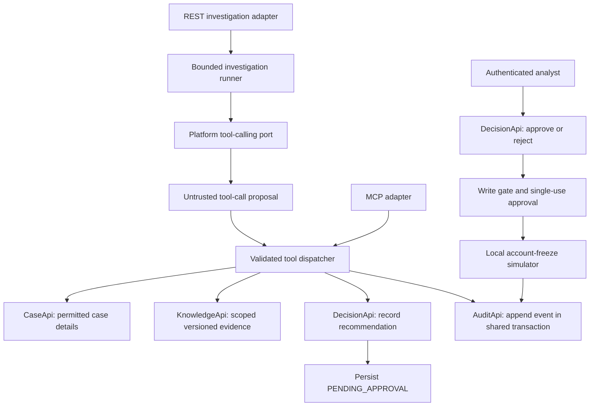

<!--
============================================================================
FILE:        docs/week28-implementation-plan.md
PURPOSE:     Map Week 28 learning resources to ordered, testable implementation modules.
OWNER:       Investigation Orchestration / Decision & Action / Platform
SINCE:       week-28
RELATED:     context.md, ADR-001 through ADR-005, docs/project-learning-guide.md
NOTES:
  - This is an implementation plan, not evidence that Week 28 features are built.
  - Preserve accepted architecture documents and applied migrations.
  - Each implementation file must explain how it works and defend its decisions.
============================================================================
-->

# Week 28 implementation plan: bounded agents, tools, MCP, and human approval

Prepared 19 October 2026 for implementation together, with explanations and review at each milestone.

## 1. Target outcome and limits

Build one complete learning scenario: investigate a synthetic case, retrieve permitted versioned evidence, record a proposed account freeze, obtain an authorized human decision, execute a simulated freeze through a deterministic gate, and reconstruct the history from persisted events.

The model requests tools. Application code validates and dispatches requests. Human approval authorizes the consequential action. MCP exposes selected capabilities through an additional protocol adapter; it does not confer permission or replace business rules.

Completion requires the working path AND rejection evidence. A model producing plausible JSON or a class named `WriteGate` is insufficient.

This week includes an authenticated, bounded workflow and a replayable event history. Full Temporal scheduling, recovery after arbitrary process failure, compensation, and external-effect delivery remain Week 29 work. Replay here means reconstructing history without re-running tools or the model. The account action remains a local simulator, never a banking integration.

## 2. Existing context and practices to preserve

Sources reviewed: [repository context](../context.md), [learning guide](project-learning-guide.md), [Week 27 walkthrough](week27-implementation.md), accepted ADRs, package documentation, `.editorconfig`, Maven configuration, and the API boundary map. No `AGENTS.md`, `.agents`, or `.codex` instruction files were found in the inspected repository/ancestor locations.

Apply these practices throughout implementation:

1. Keep the eight bounded contexts. New `tools` and `mcp` packages are subpackages of their owning context, not new services or bounded contexts.
2. Cross-context dependencies use published `api` contracts. A transport adapter must not import another context's repository or domain internals.
3. Keep provider SDKs inside the platform model gateway. Expose any new calling contract through `platform.api`; do not introduce more cross-context imports of gateway internals.
4. Preserve Week 25 documents and accepted ADRs. Record new decisions in proposed records or implementation notes; supersede an ADR explicitly if its actual decision changes.
5. Preserve Week 26 ingestion and Week 27 retrieval behavior, with regression tests. Add migrations after the current V7; do not rewrite V3/V4/V5 placeholders that may already be applied.
6. Use the exact explanatory header template in `context.md`: FILE, CONTEXT, LAYER, PURPOSE, OWNER, SINCE, RELATED, NOTES. Use `SINCE: week-28` for new files and retain original introduction dates for existing files. Explain **how** the file works and **why** the design was chosen in NOTES. Use matching comment syntax for Markdown, YAML, SQL, and configuration.
7. Every added package gets `package-info.java` defining responsibility, owner, and permitted imports. Follow `.editorconfig`, including four-space Java indentation.
8. Introduce typed records, enums, and explicit contracts instead of expanding the existing `Object` placeholders. Validate model-generated payloads before using them.
9. Use synthetic data. Preserve classification and evidence versions; keep C3 outside model-facing tool results, prompts, and ordinary logs.
10. At each milestone: explain the data flow, implement a small slice, verify normal and failure behavior, review the choice, and record AI assistance and human decisions.
11. Update the AI usage log using its existing five-column table. Do not invent human acceptance or mark an unrun test as passed.
12. Group commits logically after checking exactly what is staged. Exclude `.runtime`, secrets, downloaded models, raw local sources, and generated local clutter. Create `week-28` only on the complete verified committed snapshot.

### Interpret historical scaffold restrictions correctly

`context.md` originated as a scaffold task. Its instructions to leave business logic empty and defer retrieval/gateway implementation describe that earlier task; they do not freeze the project permanently. Its architecture and documentation conventions remain relevant to this plan.

It also defers Spring Security to Week 31 and says to ask before adding dependencies outside its listed stack. Week 28 now requires trusted identities and permission checks. **Proposed resolution:** introduce the minimum supported security integration for this module, document the sequencing exception, and retain broader hardening for Week 31. Review the exact dependency list before changing `pom.xml`, following the context's dependency rule. This plan installs nothing and requests no dependency approval prematurely.

## 3. Resource-to-module alignment

| What you studied | Backend concept | Module to implement | Proof of understanding |
|---|---|---|---|
| Function/tool calling | Model returns a tool name, arguments, and call ID; the application chooses whether to execute | `platform` calling port and `orchestration` dispatcher | Capture a real model call and the validated tool result; reject fabricated tool names |
| Tool descriptions and JSON schemas | Machine-readable contracts help the model request the right operation | Catalog projections and typed tool inputs | Invalid fields, oversize inputs, and disallowed actions fail before execution |
| Spring AI tools | `ToolCallback` or carefully controlled `@Tool` adapters can expose Java behavior | Adapter inside the owning context | Annotation/schema generation does not bypass service-level authorization |
| Agent reasoning loops | Tool result becomes context for a subsequent model turn | Bounded investigation runner | Stop on a recommendation, invalid output, timeout, repeated call, or turn budget |
| MCP host/client/server | Compatible clients discover and invoke server capabilities | `orchestration.infrastructure.mcp` adapter | Real protocol discovery/invocation, not just a REST endpoint labelled MCP |
| MCP tools | Protocol entry points wrap approved backend operations | Read tools and recommendation-proposal tool | MCP and internal dispatch enforce the same case and permission checks |
| MCP resources/prompts | Optional ways to expose context/templates | Later extensions after the tool workflow | Resources obey access controls; prompts do not grant privileges |
| Human approval and least agency | A model recommendation is not execution authority | `decision` approval and write gate | Investigator cannot approve or directly freeze an account |
| State and replayability | Persist the operation history and allowed transitions | `orchestration`, `decision`, and `audit` | Reconstruct the same history without repeating side effects |
| Input/output validation | Model/MCP data is untrusted input | Service contracts and gateway decoding | Bad arguments, unknown citation IDs, and unsupported outputs are rejected |

Tool calling and function calling describe the same general interaction pattern here; they are not separate business modules. MCP is an adapter/protocol concern. Avoid implementing identical tool logic three times for REST, Spring AI, and MCP.

## 4. Architecture documents and decisions

| Reference | How it governs Week 28 |
|---|---|
| [ADR-002: Human approval](adr/ADR-002-Human-in-the-Loop.md) | Primary contract: signed, action/evidence-bound approval; deterministic write authority; analyst authentication and step-up requirement |
| [ADR-001: Modular monolith](adr/ADR-001-Modular-monolith-first.md) | Public boundaries, schema ownership, one local transactional action/audit boundary |
| [ADR-003: Model gateway](adr/ADR-003-Model-Provider-Abstraction.md) | Provider isolation, version capture, classification and budget controls |
| [ADR-005: Knowledge product](adr/ADR-005-Knowledge-base.md) | Exact source/corpus versions and evidence digests reviewed by the analyst |
| [ADR-004: Durable workflows](adr/ADR-004-durable-workflow-engine-for-investigations.md) | Define resumable state now; integrate full durable orchestration in Week 29 |
| [Boundary map](api/service-boundary-map.md) and [context map](architecture/bounded-contexts.md) | Assign ownership and enforce authorization in receiving services, not only the HTTP edge |
| [Classification](data-classification.md), [risks](risk-assumptions.md), [SLOs](slos.md) | Minimize tool data, identify failure cases, and distinguish targets from measured guarantees |
| [Week 27 failures](week27-failure-and-tuning-notes.md) | Valid quotations can still be irrelevant; citations alone cannot justify an account action |

Propose a new ADR for **bounded tool dispatch and protocol-independent approval enforcement**. Record transport choice, model-call budget, identity propagation, empty write allowlist, approval consumption, and transaction semantics. Do not call the proposal Accepted before human review. Keep version/library compatibility notes separate from architectural claims.

## 5. Module boundaries and end-to-end flow



The investigator never receives an executable freeze callback. The dispatcher rejects an execution attempt even if a model invents its name. The analyst approval and execution adapters call the same decision service; no alternate route contains its own weaker copy of the gate.

## 6. Ordered implementation milestones

### Step 0 — Establish the baseline and review contracts

**Resources:** architecture boundaries, model/provider strategy, input schema examples.

- Inspect Git state and preserve existing edits. Identify required untracked runtime files before claiming a clean checkout builds.
- Run the existing suite against a fresh disposable pgvector database. The saved Week 27 evidence records 43 passing tests; it is historical evidence, not a fresh baseline run.
- Define one fixture case, permitted actors, approved evidence sources, and the simulated account state.
- Write the proposed decision record and agree the dependency/security sequencing exception before altering the build.

**Exit check:** baseline failures are understood; exact roles, tool contracts, and demonstration boundaries are documented.

### Step 1 — Public contracts and minimal trusted identity

**Resources:** permission scopes, least privilege, validated schemas.

**Owners/files:** existing `platform/api`, `platform/security/SecurityConfig.java`, `cases/api/CaseApi.java`, `decision/api/DecisionApi.java`, and their DTO packages. Proposed supporting types include `CallerContext`, `ToolCallRequest`, `RecommendationRequest`, and `ApprovalDecisionRequest`.

- Introduce investigator, analyst, and auditor authorities plus explicit case-access grants.
- Derive identity from verified authentication. Never accept actor identity, roles, clearance, or MFA status from ordinary tool arguments or arbitrary headers.
- Add maintained framework authentication support rather than hand-writing a password/authentication mechanism. Separate API access credentials from action approval tokens.
- For ADR-002's step-up requirement, consume a verified identity-provider assertion with an agreed issuer, audience, authentication method, and freshness rule. A body flag such as `mfaVerified=true` is not proof.
- Test identities/step-up assertions may be simulated in isolated tests. Label a local demonstration accordingly; simulated MFA does not establish end-to-end production MFA or complete ADR-002 compliance.
- Protect legacy evidence routes as well as new investigation routes; otherwise an alternate HTTP entry can bypass a new identity restriction.

**Exit check:** unauthenticated access is rejected; investigator cannot approve; analyst cannot access an unrelated case. No model call is needed yet.

### Step 2 — Add schema and append-only event contracts

**Resources:** state transitions, auditability, replay.

**Owners/files:** existing `AuditApi`, `AuditEvent`, `AuditAppender`, `AuditEventRepository`; case/decision/orchestration repositories under their own contexts. Proposed migrations after V7: `V8__investigation_and_approval_state.sql`, then `V9__audit_event_history.sql`; check the actual next numbers when implementing.

Persist case grants, investigation state/version, recommendations, evidence snapshots, approvals, execution idempotency/results, simulated account state, and ordered workflow events. Store only necessary evidence excerpts/references; classify them appropriately.

- Each context owns its tables and SQL. Shared transaction does not authorize cross-context repository imports or cross-context SQL joins.
- For a local action, call `AuditApi` in the same transaction using the same datasource/transaction manager; the audit implementation owns its SQL. Make the transactional requirement explicit.
- Record rejected attempts outside a transaction that is already being rolled back. Otherwise the rejection evidence disappears. Avoid sensitive token/prompt bodies in these events.
- Use an event sequence and state version to reject invalid/concurrent transitions. Reconstruct history without calling models or executors.
- Append-only application APIs are not absolute immutability against a database administrator. Document database privileges, and do not promise tamper-proof storage without implementing its controls.

**Exit check:** fresh migrations apply, rollback behavior is proved, and state history can be read in order.

### Step 3 — Publish safe case and knowledge operations

**Resources:** read tools, RAG evidence, source traceability.

**Owners/files:** `cases/api/CaseApi.java`, `knowledge/api/KnowledgeApi.java`, a knowledge API implementation, and scoped changes to existing retrieval services/repository.

- Complete `CaseApi` for permitted synthetic case details.
- Complete the currently scaffolded `KnowledgeApi` as the cross-context retrieval entry. Orchestration must not import `knowledge.retrieval` internals directly.
- Pin the investigation's published corpus and retrieval configuration. Preserve source revision, chunk ID/hash, and model/version references.
- Enforce the minimum of trusted caller clearance and configured service ceiling before ranking in both retrieval strategies. Week 27's global development ceiling is not a per-user access model.
- Enforce case-specific evidence scope as well as classification. A C2 clearance does not mean every C2 prior case is visible. Model that scope as allowed source IDs/relationships and bind it into SQL, not a post-filter after exposing content to the model.
- Never expose index/re-ingestion controls or raw local file URIs as agent tools.

**Exit check:** permitted evidence is returned with citations; wrong-case, above-clearance, C3, and unapproved-source access are rejected before model disclosure.

### Step 4 — Build the catalog and deterministic dispatcher

**Resources:** tool definitions, JSON schemas, function-call dispatch.

**Owners/files:** `decision/domain/ActionCatalog.java`, `ActionType.java`, `AllowlistPolicy.java`, public catalog DTOs in `decision/api`; proposed dispatcher/handlers under `orchestration`.

| Capability | Model-visible? | Permission/effect |
|---|---|---|
| `get_case_details` | Yes | READ; permitted case fields only |
| `retrieve_case_evidence` | Yes | READ; pinned snapshot and access scope |
| `propose_account_freeze` | Yes | Proposal-record mutation; creates no account restriction and cannot authorize itself |
| `approve_action` / `reject_action` | No | Analyst-only decision operations |
| `execute_account_freeze` | No | Consequential WRITE; decision gate only |

Use an explicit capability registry and allowlisted dispatch, not arbitrary method-name reflection. Model-provided arguments cannot replace the server's investigation ID, caller context, version bindings, or authority.

Distinguish consequential WRITE actions from internal recommendation/event persistence. The proposal handler may persist an unapproved recommendation only through `DecisionApi`; it must not import or invoke the account executor.

Keep `src/main/resources/corpus/policies/allowlist.yml` empty for consequential automation. Its current header references a different historical path; use the actual existing location and document any later move.

**Exit check:** unit/integration tests prove schema checks, unknown-tool rejection, permission checks, safe error results, and correlation of each result to its tool-call ID.

### Step 5 — Add actual model function calling through the gateway

**Resources:** model/tool request/result turns, Spring AI tool callbacks, bounded agent execution.

**Owners/files:** a proposed public `platform.api.ToolCallingPort` with typed request/response DTOs; gateway implementation/provider adapter remains inside `platform`. An investigation runner owns the turn loop in `orchestration`.

The existing Week 27 `EvidenceAnswerPort` chooses quotations; it is not an agent/function-calling interface. Reuse local-provider infrastructure where suitable, but do not pretend structured quotation output is a native tool call.

- Select and verify an installed local chat model that actually supports tool calling. EmbeddingGemma is an embedding model; the existing optional quote-selection model is not automatically suitable.
- First use scripted model-call fixtures to prove control flow without nondeterministic failures. Then capture a real local model/tool round trip as separate evidence.
- Translate backend tool definitions to Spring AI tool callbacks/schemas or an explicit provider tool-call contract, using APIs compatible with the pinned Spring AI 1.0.9 line.
- Each exposed callback must enter the same dispatcher. Disable broad automatic tool discovery/execution that could bypass the approved catalog or hard budgets.
- Start with one tool call per model turn. Reject or explicitly validate multiple-call responses; do not accidentally execute an unbounded batch.
- Propose initial configurable limits: six model turns, three read calls, one recommendation, per-call timeout, and an overall deadline. Count budgets outside model instructions.
- Stop on a persisted recommendation, abstention, invalid output, repeated-call limit, or exhausted budget. Tool output is data, not higher-priority instructions.
- Freeze the evidence/version snapshot attached to the recommendation. Invalid or unsupported evidence cannot be repaired by assigning a higher model confidence.

**Exit check:** the model can request a permitted read tool and receive its result, but cannot discover/execute a freeze or manufacture analyst approval. Budget-exhaustion tests terminate deterministically.

### Step 6 — Enforce the persisted workflow state machine

**Resources:** controlled agent steps, state transitions, human-in-the-loop pause.

**Owners/files:** existing orchestration contracts and a minimal application service; proposed workflow state/repository types. Avoid turning a future Temporal workflow implementation into an incompatible ad hoc HTTP service.

Proposed investigation states:

```text
NEW → INVESTIGATING → PENDING_APPROVAL → APPROVED → EXECUTED
                   ↘ INSUFFICIENT_EVIDENCE
                     PENDING_APPROVAL → REJECTED
                     APPROVED → FAILED
```

Keep the investigation/action lifecycle distinct from the existing case lifecycle. Do not add enum values to `CaseState` just to mirror another aggregate. Use a persisted version for optimistic concurrency.

Run model work in a bounded worker, return an investigation ID from launch, and expose status/events. Persist `PENDING_APPROVAL` and return; do not hold a thread, transaction, or future open while a human decides. Explicit approval/execution commands resume the persisted state for this milestone. Automatic crash recovery/durable scheduling is Week 29 scope.

**Exit check:** invalid transitions and duplicate launches are handled predictably; a reconstructed history does not repeat model calls or action execution.

### Step 7 — Bind human approval to one exact recommendation

**Resources:** human control, permission scopes, least agency.

**Owners/files:** existing `ApprovalTokenService`, approval DTOs/controller, and recommendation/approval repositories.

- Use a maintained signing/verification library, a fixed allowed algorithm and trusted key configuration; do not invent a cryptographic encoding.
- Bind approval to approval ID, case, action type/target/parameters, recommendation version, evidence digest, corpus/retrieval/model/prompt versions, authorized approver, audience, and expiry.
- Canonicalize and version the server-owned action/evidence payload before hashing. Persist it; do not recompute from mutable client-supplied fields.
- Require verified analyst authority and the chosen step-up assertion. Prevent approval by the investigator identity.
- Rejection/override is a first-class recorded outcome. Changing action or evidence invalidates the prior approval and requires a new review.
- Persist token identifier and consumption state. Store no raw approval token or signing key in logs/events/model context.

**Exit check:** missing, expired, tampered, wrong-case, wrong-parameter, stale-evidence, and unauthorized approvals are rejected. A signature alone is not single-use protection.

### Step 8 — Execute the simulator through the single write gate

**Resources:** read/write boundaries, input validation, auditability.

**Owners/files:** `WriteGate.java`, `ActionExecutor.java`, decision execution service/repository, `ActionController.java`, and local simulator.

For an execution request: authenticate and authorize again; load the persisted recommendation; validate its state and exact approval binding; check expiry/revocation; consume approval atomically; apply the local simulated freeze; persist the idempotent result and audit event in one transaction.

Use a conditional update/row lock so two concurrent uses cannot both succeed. A repeated matching idempotency key returns the existing logical result; the same key with different inputs is a conflict. Transaction failure rolls back consumption and the simulated action together.

Do not claim this atomicity for a real external account API. External effects and outbox delivery/reconciliation need Week 29 treatment. If using `AuditOutbox`, distinguish atomic durable audit intent from an audit event delivered later; do not claim eventual delivery is already synchronous atomic auditing.

**Exit check:** concurrent replay gives at most one logical freeze; simulated failure rolls back state/approval consumption; the model has no executor reference.

### Step 9 — Expose the safe capabilities through MCP

**Resources:** MCP discovery, invocation, transport, authorization, and tool-result errors.

**Owners/files:** proposed `orchestration/infrastructure/mcp/InvestigationMcpAdapter.java` and configuration; no new bounded context.

Start with a local stdio MCP transport using a narrowly scoped, server-configured investigator identity and case grants. Select the matching Java SDK/Spring AI starter against the existing BOM at the dependency gate; do not hand-roll JSON-RPC or copy APIs from an incompatible current release. Protocol stdout must contain protocol messages only; direct ordinary logs to stderr.

Implement protocol initialization/capability negotiation and normal tools discovery/call handling through the supported SDK. Expose only the three investigator capabilities from Step 4, filtered by the server identity. Discovery is informational; every invocation still authorizes.

For stdio, client process launch provides the context for provisioning the local identity; do not let tool arguments claim another identity. This is a local development transport, not remote multi-user authentication. Do not launch a separate writer against an unauthenticated API or clone the decision logic into a second process.

If HTTP MCP is later selected, document its actual supported transport/version, authenticated caller mapping, and applicable MCP authorization flow. Do not label arbitrary headers or a homegrown token-passthrough mechanism as protocol-compliant OAuth. Keep the same dispatcher and decision service behind it.

MCP resources/prompts are optional after the core tools pass: a safe resource might return permitted case/evidence references, while a prompt template can describe an investigation procedure. Neither substitutes for authorization or human approval.

**Exit check:** a real SDK client can initialize, list permitted tools, call a permitted read, and receive structured failures for unsafe/wrong-case requests. No write executor or analyst approval tool appears in the investigator catalog. The REST/in-process/MCP parity tests pass.

### Step 10 — Prove behavior and prepare the submission

**Resources:** replayability, human oversight, unsafe-action tests, AI verification practice.

Run the normal path and every rejection case against fresh Testcontainers PostgreSQL. Preserve Week 26/27 regression tests. Scripted model tests prove backend controls; a separate live local-model demonstration proves model integration. SDK-level MCP tests prove protocol integration; a plain Java handler test does not prove MCP interoperability.

Export synthetic-only event histories and results to `docs/evidence/week28/`. Add `docs/week28-implementation.md`, tool/input/permission documentation, test commands, limitations, and a failure demonstration. Update the README with a requirement-to-artifact table and append an AI usage entry in the existing log table.

Suggested logical commits: contracts/security; schema/audit; public case/evidence services; catalog/dispatcher; bounded model loop; approvals/simulator; MCP adapter; tests/evidence/docs. Stage only reviewed files. Run the final verification, inspect the committed snapshot, then create/push `week-28` when publishing is requested.

**Exit check:** a reviewer can clone the committed repository, follow setup, inspect both the successful workflow and blocked unsafe attempts, reconstruct event history, and find the matching tag.

## 7. Test matrix and evidence

| Scenario | Expected proof |
|---|---|
| Unknown tool, malformed JSON, extra forbidden fields | No handler or side effect; structured failure |
| Investigator requests another case's data | Denied before retrieval/model disclosure |
| C3/above-clearance evidence request | Denied or excluded by owning knowledge service before ranking |
| Model invents execution/approval tool | Dispatcher rejects it; no approval or freeze |
| Tool result includes adversarial instructions | No extra authority or expanded catalog; loop remains bounded |
| Missing/forged/expired/consumed approval | No simulated account mutation |
| Action parameters/evidence change | Existing approval cannot authorize the new recommendation |
| Two concurrent executions | One logical result/action and correct consumption state |
| Same idempotency key, different payload | Conflict, not a second action |
| Audit append/action transaction fails | Local action and approval consumption roll back together |
| Rejected attempt | A separate safe audit record survives the failed operation |
| Replay event history | Same ordered state reconstruction; zero new model/tool/action calls |
| Repeated model tool request or exhausted budget | Deterministic stop and recorded reason |
| MCP versus REST/in-process invocation | Same permission and validation outcome |
| Unavailable local model/unsupported tool-call response | Explicit failure/abstention, never fabricated success |

Suggested test files: `ToolDispatcherTest`, `InvestigationStateMachineTest`, `ApprovalBindingTest`, `WriteGateIntegrationTest`, `AuditTransactionIntegrationTest`, `WorkflowReplayTest`, `InvestigationMcpIntegrationTest`, and strengthened architecture boundary tests. These are proposed names, not existing test evidence.

## 8. Delivery checklist

- [ ] Multi-step investigation with explicit bounds and persisted state.
- [ ] Catalog with tool schemas, permissions, read/write effect classification, and model-visible subset.
- [ ] Trusted authentication/case access; real versus simulated step-up status documented accurately.
- [ ] Human approval before every simulated consequential write; empty automatic-write allowlist.
- [ ] Signed, short-lived, action/evidence-bound approval with persisted atomic consumption.
- [ ] Idempotent simulator and correctly defined local transaction/audit boundary.
- [ ] Replayable state history and unsafe-action rejection tests.
- [ ] Real function-call round-trip evidence and genuine MCP protocol-client tests.
- [ ] Headers, package documentation, regression results, README, AI log, setup, and limitations.
- [ ] Complete committed snapshot and `week-28` tag at submission time.

## 9. Learning questions for each review

Before moving on, explain: who creates each Spring bean; where identity originates; what is trusted versus model-controlled; which module owns the data; what commits or rolls back; what prevents another transport bypassing the rule; and which test demonstrates the answer.

First implementation session: finish Step 0 and the typed contracts/identity design in Step 1. Do not start by exposing every Java method to the model or by connecting a real account system.

## 10. Official resource references

The resource mapping uses the versioned [Spring AI 1.0 tool-calling reference](https://docs.spring.io/spring-ai/reference/1.0/api/tools.html), [Spring AI 1.0 MCP overview](https://docs.spring.io/spring-ai/reference/1.0/api/mcp/mcp-overview.html), and the versioned MCP specifications for [tools](https://modelcontextprotocol.io/specification/2025-06-18/server/tools) and [authorization](https://modelcontextprotocol.io/specification/2025-06-18/basic/authorization). These explain application-managed tool execution and protocol boundaries; select a mutually supported protocol/SDK version when implementing rather than assuming a published specification implies support in the pinned libraries.


## Implementation status — 20 October 2026

See [the implementation walkthrough](week28-implementation.md) and
[verification evidence](evidence/week28/verification.md) for implemented scope.

| Plan area | Implementation status |
| --- | --- |
| Baseline and typed identity | Framework authentication, role capabilities, CSRF, and trusted caller port implemented. |
| Persistence | Additive V8 cases/grants/sources, V9 audit, V10 decisions/simulator, V11 investigation runs. |
| Case-scoped knowledge | Public APIs and SQL scope before ranking; empty scope fails closed. |
| Tool catalog/dispatch | Two READ tools and one PROPOSAL capability with strict schemas; consequential WRITE remains gated. |
| Function calling | Native local Ollama adapter and controlled wire tests; optional live-model evidence is separate. |
| Workflow | Bounded in-process worker, persisted state/events, effective status from the recommendation aggregate; no Temporal recovery claim. |
| Approval | Maintained JOSE JWTs, immutable binding, expiry, identifier replacement on verified renewal, single-use state. Runtime step-up adapter denies; tests explicitly simulate verification. |
| Simulator/audit | Atomic local effect, consumption, result and audit; rollback and concurrency tests. |
| MCP | Supported SDK stdio server, configured local investigator/case, shared dispatcher, real client/process smoke test. |
| Submission | Walkthrough, proposed ADR-006, AI log, and verification notes. Human review, final commit, and week-28 tag remain user actions. |

Dependency additions were explicitly approved by the user: Spring Security starter,
security test support, Spring AI MCP server starter, and Spring Security OAuth2 JOSE.
The original scaffold's Week 31 security deferral does not describe this authorized
Week 28 authentication implementation. Production MFA and broader AI security are
still later work. The refined state/schema choices are documented in proposed ADR-006.
