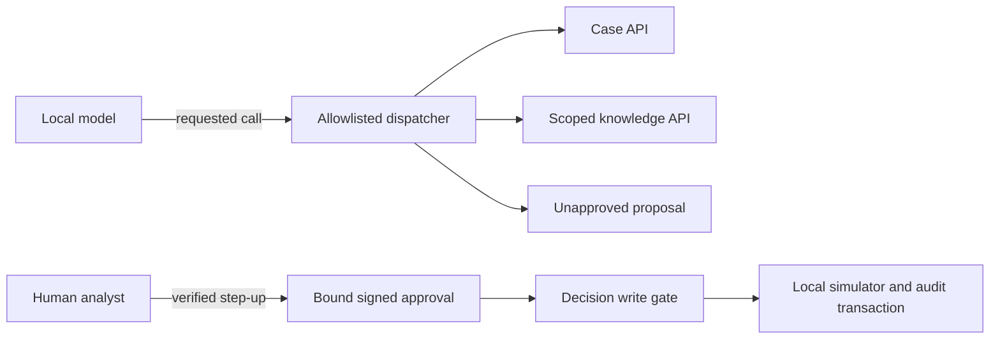

<!--
============================================================================
FILE:        docs/week28-implementation.md
PURPOSE:     Explain and track the first Week 28 implementation slice.
OWNER:       Platform & Operations
SINCE:       week-28
RELATED:     ADR-001, ADR-002, docs/week28-implementation-plan.md
NOTES:
  - This records implemented behavior separately from planned authentication and tools.
  - No MCP server, model tool loop, or account action is exposed by this slice.
============================================================================
-->

# Week 28 implementation walkthrough

## Slice 1: typed contracts and an authorization policy

Start with `platform/api/Permission.java`. A capability describes an allowed operation.
It is separate from a role: a later trusted security adapter will map investigator,
analyst, and auditor roles to capabilities. `APPROVE_ACTION` remains distinct from
`PROPOSE_ACTION`; neither proves MFA or authorizes execution by itself.

`CallerContext` is an immutable Java record. Its compact constructor rejects invalid
subjects and copies the permission set. Otherwise, code retaining the original set
could add approval rights after the caller was created. This object is a trusted
application value, not authentication proof and not a request body.

`CurrentCaller` is the platform port through which application services obtain a
verified identity. The initial deny-all adapter has now been replaced by
`SpringSecurityCurrentCaller`, a Spring `@Component` registered through component
scanning. It translates authenticated Spring Security authorities into immutable
public capabilities. Missing and anonymous authentication are rejected. It does
not inspect request bodies, `X-Actor-Id`, or role headers.

`CaseReadPolicy` checks two independent conditions: the caller has `READ_CASE`, and
the requested case appears in server-owned assignments. Both are required. The
case service fetches assignments itself; an HTTP body or tool argument
must never supply them. Every rejection uses the same message so it does not reveal
whether a case exists. Evidence clearance is checked separately before retrieval.

`CaseApi.getCase(String)` replaces an unused `Object` creation placeholder with a
typed read contract. Its implementation resolves `CurrentCaller` and
applies the policy before returning a `CaseDto`. The case controller and service now implement this contract using persisted grants. The response has an identifier, public status, and
summary, without exposing a persistence entity or importing the case domain into
its public DTO package. Summaries will still require classification/redaction when
actual data is loaded; a DTO alone does not sanitize text.

## Connection to the resources

| Studied concept | Implemented foundation | What remains |
| --- | --- | --- |
| Tool/function schemas | Typed APIs, strict tool schemas, explicit dispatch, and native Ollama call/result turns. | Wider real-model evaluation. |
| Permission scopes | Role mapping, persisted grants, source allowlists, and SQL clearance checks. | Production identity-provider integration. |
| MCP identity boundary | Real stdio transport binds a configured investigator and case to the shared dispatcher. | Remote multi-user authorization. |
| Human approval | Signed bound tokens, separate human commands, single-use state, simulator transaction, and audit. | Actual verified MFA adapter; tests explicitly simulate it. |

See [proposed ADR-006](adr/ADR-006-Authenticated-tool-boundaries.md) for the boundary
decision and alternatives. It remains proposed for human review.

## Review of the choices

The policy has no Spring dependency, so its security decisions can be tested without
starting a server or model. The public port keeps framework authentication out of
case logic. The authenticated adapter keeps caller identity separate from request data. Case reads now work through the persisted-grant service.

The current policy accepts server-owned assignments as a set for isolation and
testability. The case repository now persists grants, and the case service loads them. Do not
expose this policy signature directly as a tool or REST endpoint.

## Slice 2: authenticated HTTP boundary

The user approved `spring-boot-starter-security` and test-scoped
`spring-security-test` on 20 October 2026. Spring Boot manages both versions;
resolved Spring Security is 6.5.6. This explicitly advances minimal authentication
from the original scaffold's Week 31 deferral to support Week 28's permission tests.
Production identity-provider integration and verified step-up MFA remain deferred.

`SecurityAccounts` binds `engine.security.accounts` configuration into typed Java
records. Every configured account requires a username, a BCrypt password hash,
and one role. An empty list creates an empty user store: no default account or
generated password can authenticate. Malformed hashes and duplicate usernames
fail startup instead of silently weakening authentication.

| Role | Capabilities | Intended use |
| --- | --- | --- |
| INVESTIGATOR | READ_CASE, READ_EVIDENCE, PROPOSE_ACTION | Investigate assigned cases; cannot approve. |
| ANALYST | READ_CASE, READ_EVIDENCE, APPROVE_ACTION, READ_AUDIT | Review assigned cases; approval additionally needs a signed token and verified step-up. |
| AUDITOR | READ_CASE, READ_EVIDENCE, READ_AUDIT | Read assigned cases; cannot propose or approve. |
| KNOWLEDGE_CURATOR | MANAGE_KNOWLEDGE, READ_GLOBAL_EVIDENCE | Explicit operational access to legacy ingestion and globally scoped retrieval. |

`SecurityConfig` declares Spring beans. A bean is an object constructed and managed
by Spring; the framework injects it where an interface or constructor needs it.
The `UserDetailsService` verifies configured users through the framework's password
encoder. The `SecurityFilterChain` runs before controllers and matches each route
to its capability. Unknown routes are denied. Only health probes are public.

Existing ingestion/index routes require `MANAGE_KNOWLEDGE`; both retrieval aliases
and answers require `READ_GLOBAL_EVIDENCE`. Ordinary case roles receive neither.
This keeps the legacy global corpus route from bypassing case grants while Step 3
builds properly scoped evidence retrieval. Curator access is an explicit broad
operational grant; use synthetic learning data in this stage.

Basic authentication must stay on loopback for this learning setup, or behind TLS.
The existing `local` profile binds to `127.0.0.1`. This is not production SSO or MFA.
Authentication is checked on every request; the security context is not persisted
in the session. A session is used only to retain CSRF state.

CSRF remains enabled because browsers can cache Basic credentials. Clients first
GET `/v1/security/csrf`, retain its `JSESSIONID` cookie, and send the returned token
under the returned header name on POST requests. The token is not an approval
token. The response's `toString()` redacts it from Spring response-body debug logs.
`GET /v1/security/me` reports the verified subject and capabilities, without MFA claims.

Error dispatches are permitted so existing controller validation/conflict errors
retain their correct status instead of being replaced by a second access denial.
This does not permit an ordinary external request to `/error` or another denied route.
Anonymous identity requests return 401. A POST without CSRF may be rejected with
403 before authentication, as expected from the framework filter ordering.

## Try the local setup

Create a BCrypt hash with a password tool you trust. On this machine Apache's
`htpasswd` is available; this prompts for the password rather than putting it in
shell history:

```bash
htpasswd -nBC 12 local-curator
```

The output is `local-curator:<hash>`. Copy only the hash and prefix it with
`{bcrypt}`. Set these in your local shell; keep the hash quoted because it contains
`$` characters. Replace the placeholder before starting:

```bash
export ENGINE_SECURITY_ACCOUNTS_0_USERNAME=local-curator
export ENGINE_SECURITY_ACCOUNTS_0_PASSWORDHASH='{bcrypt}<your hash>'
export ENGINE_SECURITY_ACCOUNTS_0_ROLE=KNOWLEDGE_CURATOR
mvn spring-boot:run -Dspring-boot.run.profiles=local,ollama
```

These variables are read by Spring's configuration binder. `.env.example` is
reference material; Maven does not automatically load it. For additional accounts,
use consecutive indexes `_1_`, `_2_` and appropriate roles. Never commit actual
credentials or hashes. Without configured accounts the server starts but logins fail.

Fetch a token and cookie, then run a protected operation. `curl --user` prompts for
the password. The example uses Python only to extract the returned JSON fields:

```bash
curl --fail --user local-curator -c /tmp/fraud-cookies \
  http://127.0.0.1:8080/v1/security/csrf -o /tmp/fraud-csrf.json
csrf_header=$(python3 -c 'import json; print(json.load(open("/tmp/fraud-csrf.json"))["headerName"])')
csrf_token=$(python3 -c 'import json; print(json.load(open("/tmp/fraud-csrf.json"))["token"])')
curl --fail --user local-curator -b /tmp/fraud-cookies \
  -H "$csrf_header: $csrf_token" -H 'Content-Type: application/json' \
  -d '{}' http://127.0.0.1:8080/v1/knowledge/retrieval/index
rm -f /tmp/fraud-cookies /tmp/fraud-csrf.json
unset csrf_token csrf_header
```

A completed ingestion is still required before building the index. Other POSTs use
the same authentication, cookie, and CSRF header. `GET /v1/security/me` needs Basic
authentication but no CSRF header. Existing Week 27 curl examples need these additions.

## Slice 3: persisted case grants and scoped evidence

`V8__case_access_and_source_scope.sql` adds case records, grants keyed by subject,
and source allowlists under the case-management schema. It inserts no cases or
grants. Earlier applied placeholder migrations are unchanged. Provision only
synthetic cases for this local learning stage. A grant also carries a C0–C2 ceiling;
case summaries exceeding it are denied before being returned.

`CaseRepository` joins the requested case to the authenticated subject's grant.
There is no preliminary case-existence response. `CaseService` checks capability,
resolves the persisted grant, applies `CaseReadPolicy`, and loads the source scope.
`GET /v1/cases/{caseId}` returns the typed response. Missing, unrelated, and
insufficient-clearance cases return the same 403 body.

`CaseEvidenceService` implements the public `KnowledgeApi`. It calls only the
public `CaseApi` across the context boundary. The case-source list and grant
clearance never come from a request body. `RetrievalService.retrieveScoped`
intersects grant clearance with the configured server ceiling. Both vector and
keyword SQL, including index-completeness checks, bind that source allowlist
before ranking. Empty scope returns zero passages without embedding the query.

`POST /v1/cases/{caseId}/evidence` accepts the existing bounded retrieval request.
It requires authentication, CSRF, evidence capability, and a case grant. The
legacy curator endpoints remain global operational routes. Tests deliberately
remove an index entry outside a case scope: its retrieval must still succeed,
which would fail if filtering happened only after the global search.

## Slice 4: explicit tools and native model calling

`InvestigatorToolDispatcher` implements one allowlisted registry and dispatcher.
Its JSON schemas reject extra fields and enforce string sizes and required inputs.
Every result carries its backend tool-call identifier. The dispatcher records a
separate audit observation for success or denial, including direct MCP calls.
Unknown tools, authority
claims, wrong argument types, and unavailable services return bounded errors.

| Tool | Effect | Arguments | Backend boundary |
| --- | --- | --- | --- |
| get_case_details | READ | none | CaseApi.getCase |
| retrieve_case_evidence | READ | query | KnowledgeApi.retrieveCaseEvidence |
| propose_account_freeze | PROPOSAL | evidenceQuery, rationale | Scoped retrieval, then DecisionApi.propose |

Case identity is bound outside those arguments. Proposal creation reruns scoped
retrieval and validates exact text, source versions, classifications, checksums,
and chunk identifiers against the published corpus. Model-supplied quotations
cannot substitute for stored evidence. A proposal creates a review record and
has no account effect. The consequential simulator action is classified WRITE by
`ActionCatalog` and checked by `WriteGate`; no executor or approval tool is listed.

`platform.api.ToolCallingPort` separates a model's requested call from execution.
`OllamaToolCallingAdapter` sends native function schemas to `/api/chat`, returns
one requested call, then supports an assistant-call/tool-result follow-up turn.
It rejects parallel batches and malformed responses. The installed model digest
is checked before and after each turn; a run rejects model-version changes.
The existing loopback-only HTTP client prevents a cloud fallback or redirect.

This implements the [native Ollama tool-call message flow](https://docs.ollama.com/capabilities/tool-calling).
It is separate from Week 27's quotation selector. Default agent calls are disabled:
set `INVESTIGATION_MODEL_PROVIDER=ollama` and install `qwen2.5:1.5b` to select the
local adapter. The embedding and agent chat models serve different purposes.



## Slice 5: bounded asynchronous investigation

`OrchestrationController` launches with HTTP 202. `InvestigationService` authenticates,
requires a C2 case grant for potentially sensitive run metadata, persists the launch,
and queues work in a two-worker pool with sixteen waiting slots. Identical subject/key
and payload return the existing run. Reusing a key with changed input conflicts.

The worker enforces six model turns, three reads including proposal retrieval, one
proposal, a default twenty seconds per model/tool call, and a two-minute deadline.
The call timeout can be reduced through `investigation.call-timeout-seconds` (1–20);
it cannot be raised beyond the cap. Tests use one second to verify cancellation. Repeated
calls and parallel responses fail deterministically. Timeouts interrupt cooperative
adapters; they are not a hard kill of arbitrary custom Java code. No database
transaction spans an LLM call or a human wait. `AuthenticatedWork` captures the
verified launch identity and restores worker/call thread contexts afterward.

`InvestigationRepository` persists compare-and-set state transitions, versions, and
correlated tool-result events. Each event and audit append share its transaction.
The agent lifecycle is NEW → INVESTIGATING → PENDING_APPROVAL, INSUFFICIENT_EVIDENCE,
or FAILED. Once a proposal exists, status resolves APPROVED, REJECTED, or EXECUTED
from that persisted recommendation. This avoids independently editable duplicate
approval state. The agent event stream remains separate from the action audit trail.
Reading either status or stored history never reruns the model or simulator.

In-process scheduling is intentional for Week 28. A process crash can leave NEW or
INVESTIGATING records without workers. There is no automatic recovery or Temporal
replay yet; Week 29 implements that. A FAILED launch is not silently retried under
its original idempotency key.

## Slices 6 and 7: human approval and atomic simulator execution

`V9` creates append-only audit events. Database triggers reject ordinary UPDATE,
DELETE, and TRUNCATE operations. A privileged database owner can still bypass
controls; this is not cryptographic tamper proofing. `TransactionalAuditService`
requires an existing transaction for normal append. Rejection events use a separate
transaction so rollback does not erase them. Tool observations also use their own
short transaction, without holding a database transaction across retrieval/model work.
Events exclude tokens and raw evidence.

`V10` stores recommendations, approval identifiers/expiry, simulator state, and
idempotent execution results. A database trigger prevents changing the stored
binding, rationale, proposer, or case; changed recommendations require a new proposal.
A versioned serialized binding includes the action, server-derived simulated target,
fixed parameters, rationale, exact evidence and retrieval/corpus/embedding versions,
model/prompt versions, and recommendation version. External MCP clients are explicitly
labelled model/prompt unspecified; the server does not claim to know their model context.
SHA-256 covers the stored bytes.
Identical proposals by the same subject return the same persisted recommendation.

Recommendation rationale and approval metadata are C2 even when source passages are
public. All recommendation commands and review therefore require a C2 case grant.
A human can read the exact binding through `GET /v1/recommendations/{id}`. Approval
requires analyst capability, assigned-case access, a different identity from the
proposer, current evidence scope, and verified step-up. `ApprovalTokenService` uses
the approved Spring Security/Nimbus library with fixed HS256, issuer, audience,
purpose, approver, recommendation ID, binding digest, unique token ID, and 120-second
expiry. Expired, unconsumed approvals can be reviewed again with fresh verified
step-up; renewal replaces the stored approval ID, invalidating the old credential.
Configure a separate Base64 key of at least 32 random bytes through
`APPROVAL_SIGNING_KEY`; it is not an API password. No key is generated automatically.

**Runtime MFA boundary:** `UnavailableStepUpVerifier` always rejects. Basic credentials
and a JSON flag cannot prove second-factor authentication. The isolated integration
tests replace this port to simulate a verified assertion. There is no production
identity-provider issuer/audience/method/freshness verification yet. Consequently,
a normal local analyst cannot complete approval until a real adapter is installed.
This is a deliberate deny-by-default seam, not a working production MFA system.

Execution reauthenticates, rechecks case access, locks the recommendation, checks
signature/binding/expiry/state and current evidence scope, then applies the gate.
Consumption is the locked APPROVED → EXECUTED transition. The simulated account
change, idempotent result, state change, and audit append commit together. Matching
retries return the original result; changed payloads with a reused key conflict.
Concurrent replay produces at most one effect. An injected audit database failure
rolls back the simulated change and consumption, allowing a safe retry.

`GET /v1/cases/{caseId}/audit` exposes stored case audit events to an analyst or
auditor with `READ_AUDIT` and a C2 case grant. Page with `afterSequence` (default 0)
and `limit` (1–200). Use the last returned sequence for the next page. This reads
stored events only and never repeats model calls or execution.

The simulator target is `simulated:<caseId>`. This freezes one case-linked synthetic
record, never a bank account. Its SQL atomicity does not extend to a real external
API. Rejection is persisted separately as REJECTED and cannot later be approved.

## Slice 8: real local MCP transport

The approved Spring AI MCP server starter follows the existing 1.0.9 BOM; its
resolved SDK is 0.18.3. The adapter was compiled against that actual SDK and checked
with its real client. The [Spring AI 1.0 server documentation](https://docs.spring.io/spring-ai/reference/1.0/api/mcp/mcp-server-boot-starter-docs.html)
describes the stdio starter and low-level tool registration used here.

`application-mcp.yml` enables a non-web stdio server. Normal application profiles
keep it disabled. `InvestigationMcpConfig` registers only the shared dispatcher's
investigator capabilities. A server-configured subject must already have investigator
capabilities and no approval capability. A configured case binds all calls. The
platform identity adapter restores context after every callback; body fields cannot
select another identity or case. Backend services recheck grants on every invocation.

The SDK handles initialization, discovery, JSON-RPC framing, invocation, and errors.
The Spring banner is disabled and application logs go to stderr through
`logback-mcp.xml`. Stdout contains protocol traffic only. This is local process
provisioning, not remote OAuth or multi-user MCP authentication. The backend cannot
control a client’s subsequent model choice; use an approved local client for C2 data. An MCP client can
invoke the tools directly; the built-in model runner's aggregate budgets apply to
its own investigation runs, not to an external client's entire session.

Configure the existing accounts/database plus these process variables:

```bash
export INVESTIGATION_MCP_SUBJECT=local-investigator
export INVESTIGATION_MCP_CASEID=synthetic-case-1
# Launch the built artifact directly so Maven output cannot contaminate protocol stdout:
java -jar target/fraud-investigation-engine-0.0.1-SNAPSHOT.jar --spring.profiles.active=mcp
```

The local investigator needs persisted grants. Grant provisioning is trusted operator
work, not a public API or model tool. No starter case data is inserted automatically.
Use a separate local database and a known source ID from your synthetic corpus:

```sql
INSERT INTO case_management.case_records(case_id,status,summary,classification)
VALUES ('synthetic-case-1','INVESTIGATING','Synthetic learning case','C0');
INSERT INTO case_management.case_grants VALUES
('synthetic-case-1','local-investigator','C2'),
('synthetic-case-1','local-analyst','C2');
INSERT INTO case_management.case_sources VALUES ('synthetic-case-1','<actual synthetic source_id>');
```

## API map and learning review

All POST requests require authentication, the CSRF cookie, and its token.

| Route | Purpose | Additional gate |
| --- | --- | --- |
| GET /v1/cases/{caseId}/audit | Page through action/tool audit events | READ_AUDIT and C2 case grant |
| GET /v1/cases/{caseId} | Read minimal case details | READ_CASE and persisted grant |
| POST /v1/cases/{caseId}/evidence | Scoped VECTOR/HYBRID evidence | READ_EVIDENCE, grant, source scope, clearance |
| POST /v1/investigations | Launch bounded worker | PROPOSE_ACTION and C2 case grant |
| GET /v1/investigations/{id} | Read effective persisted state | C2 case grant |
| GET /v1/investigations/{id}/events | Replay agent state/tool events | C2 case grant |
| GET /v1/recommendations/{id} | Review exact action and evidence | C2 case grant and current evidence scope |
| POST /v1/recommendations/{id}/approve | Issue bound approval token | Analyst, verified step-up, scope, pending or expired unconsumed approval |
| POST /v1/recommendations/{id}/reject | Record rejection | Analyst, C2 case grant, pending state |
| POST /v1/recommendations/{id}/execute | Apply local simulator action | Analyst, C2 case grant, valid unconsumed approval, idempotency |

Launch body: `{"caseId":"synthetic-case-1","goal":"Review the available evidence",` 
`"idempotencyKey":"learning-run-1"}`. Evidence uses Week 27's retrieval request.
Execution body contains only `token` and `idempotencyKey`; approval accepts no MFA flag.

Read the code in this order: public case/identity contracts → case service/repository
→ scoped knowledge API/SQL → tool registry → model port/provider → worker/repository
→ decision service/token/gate → transactional audit → MCP adapter. Each implementation
file explains its responsibility and decisions in its header. Spring `@Service` and
`@Repository` register injectable components; `@Transactional` establishes database
boundaries on calls through their managed proxies. That is why audit propagation and
real PostgreSQL failure injection matter more than mocking each SQL statement.

## Verification and remaining limits

Run `mvn verify` with Docker available for the PostgreSQL fixtures. The normal suite
uses deterministic embeddings/model turns and a test-only simulated step-up port.
`SecurityBoundaryTest` separately checks that the actual runtime step-up adapter denies
Basic authentication. The MCP test starts a separate application process and uses a
real SDK client; it does not handcraft a substitute REST protocol.

For a separate native local model demonstration after installing the model:

```bash
mvn -Dtest=Week28RuntimeIntegrationTest#realLocalModelRequestsAReadToolAndReceivesItsResult -Dweek28.live=true -Dsurefire.reportNameSuffix=live test
```

The test writes `docs/evidence/week28/native-tool-roundtrip.json` only after a native
model call, authorized backend read, and follow-up model turn all succeed. It uses
synthetic case data and makes zero account changes. The default suite skips this
optional download-dependent demonstration. Wire tests alone are not semantic-model evidence.

Full verification passed: **86 tests passed, zero failures/errors; one optional
live-model test skipped** (87 discovered). The optional real-model test was then
run separately and passed (1/1); its [captured native round trip](evidence/week28/native-tool-roundtrip.json)
records a real local model requesting a case read and consuming its result. See the [verification evidence](evidence/week28/verification.md)
for the test matrix and separate native-model result. Remaining work
outside the learning simulator: real identity-provider MFA, remote MCP authorization,
Temporal crash recovery, external account effects/reconciliation, comprehensive C3
redaction and production encryption, and wider model/security evaluation. No production
readiness, autonomous consequential action, commit, tag, or deployment is claimed.
